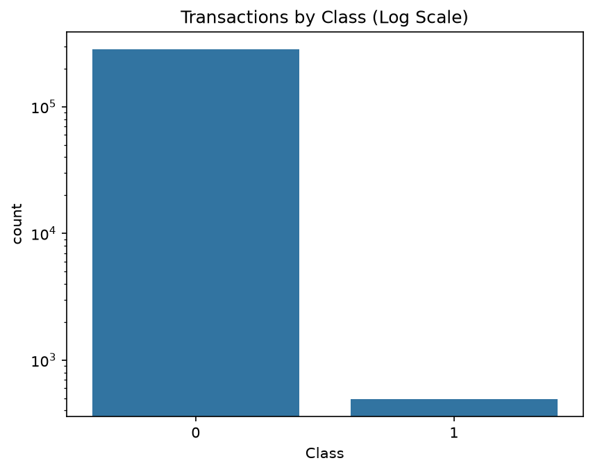
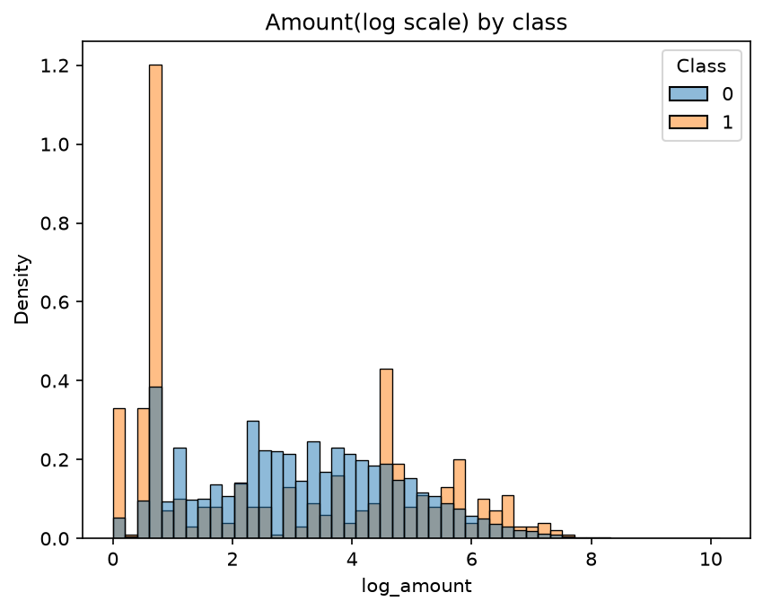
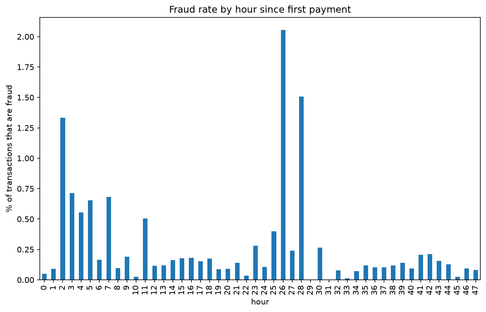
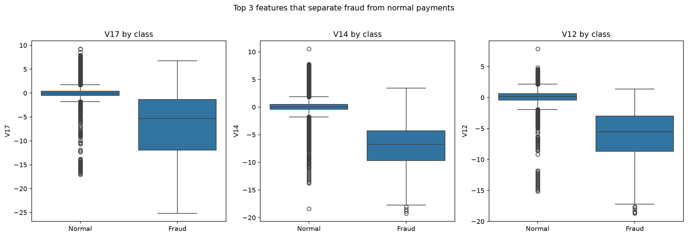
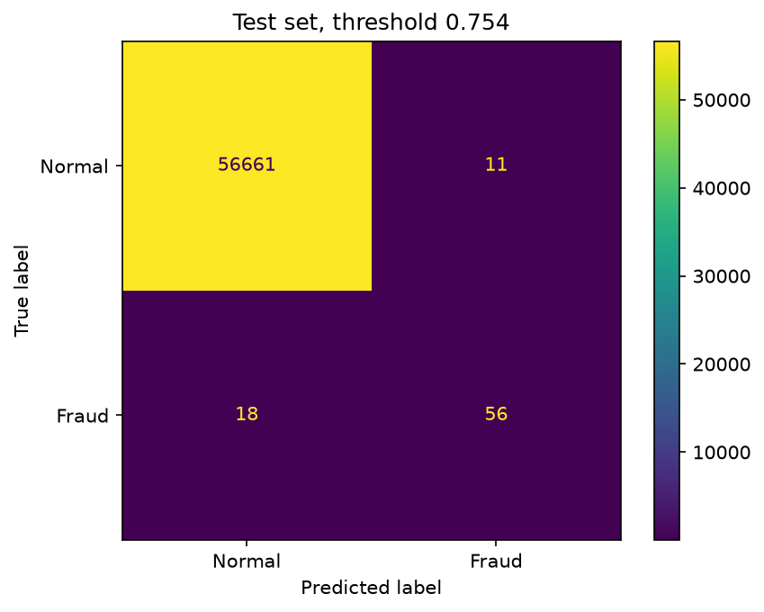

# Credit Card Fraud Detection

A machine learning project that scores credit card transactions for fraud risk. Fraud is extremely rare in this data (about 0.17% of transactions overall, and 0.13% in the test period), so the project focuses on the problems that come with imbalanced data: choosing the right metrics, validating in time order, and choosing a decision threshold.

> **Learning project.** This is built on one historical, anonymized dataset and is not a production fraud system.

## Result at a glance

On a held-out test set of the **latest 20% of transactions** (56,746 payments, 74 of them fraud), the final model:

- caught **56 of 74 frauds** (recall 0.757)
- raised **67 alerts**, of which 56 were real fraud (precision 0.836), meaning 11 false alarms among 56,672 normal payments
- reached **PR-AUC 0.786**, against 0.0013 for a model that guesses at random

The model is also served as a small FastAPI service (see [Fraud scoring API](#fraud-scoring-api)).

A model that never flags anything scores 99.87% accuracy on this test set while catching zero fraud, which is why accuracy is not used to judge the models.

## Dataset

- **Source:** [Credit Card Fraud Detection on Kaggle](https://www.kaggle.com/datasets/mlg-ulb/creditcardfraud) (ULB Machine Learning Group). Check the Kaggle page for the license and citation requirements.
- **Size:** 284,807 transactions from European cardholders over two days, 31 columns
- **Columns:**
  - `Time`: seconds since the first transaction in the dataset (not a clock time)
  - `V1` to `V28`: anonymized features produced by PCA. Their real meaning is not disclosed, so they cannot be interpreted in real-world terms
  - `Amount`: transaction amount
  - `Class`: 0 = normal, 1 = fraud (the target)
- **Not in the data:** customer IDs, merchants, or locations, so every payment is judged on its own, without any history of the cardholder.
- **Not included in this repository:** the CSV is about 150 MB, which is over GitHub's file limit. Download it from Kaggle and place it at `data/creditcard.csv`.

## Approach

1. **Exploration:** class balance, amounts, fraud over time, and which features separate the classes.
2. **Cleaning:**
   - Removed **1,081 duplicate rows** (19 of them fraud). They were identical in every column, including the timestamp. This left 283,726 rows with 473 fraud cases (0.167%).
   - Kept the 1,808 zero-amount transactions, because 25 of them are fraud, about 8 times the overall fraud rate.
   - Added `log_amount = log(1 + Amount)`, since `Amount` is heavily skewed.
   - Left out `Time` as a model feature. With a time-based split, the test period contains time values the model never saw in training.
3. **Time-based split:** the first 80% of transactions (by time) for training (226,980 rows, 399 fraud) and the last 20% for testing (56,746 rows, 74 fraud). This imitates predicting the future from the past. A random split would mix payments from the same period across both sets.
4. **Validation split:** the last 20% of the training period was held out as a validation set (45,396 rows, 52 fraud), used for comparing models and choosing the threshold. The test set was kept for the final evaluation.
5. **Models:** a baseline that always predicts "not fraud", logistic regression with class weights, and XGBoost with `scale_pos_weight` set to the ratio of normal to fraud payments.
6. **Metrics:** PR-AUC (average precision) as the main metric, plus precision and recall at a chosen threshold. ROC-AUC is reported but not relied on, because the huge number of normal payments makes it look excellent even when precision is poor.
7. **Threshold:** the cutoff on the fraud score was chosen to maximize F1 on the validation set, giving **0.754**. A rule based on a minimum precision was tried first and rejected, because it picked a cutoff at the edge of its constraint that added one caught fraud for eight extra false alarms.
8. **Final evaluation:** XGBoost retrained on the full training period with the frozen settings, then scored once on the test set.

## Exploratory analysis

### Class balance



Fraud is about 0.17% of transactions. The chart uses a log scale, because on a normal scale the fraud bar would be invisible.

### Transaction amounts



Amounts are very skewed, so the chart uses a log scale. Fraud amounts tend to be small: the median fraud payment is about 9, against about 22 for all payments.

### Fraud over time



Fraud occurs throughout the 48 hours but not evenly: the first quarter of the timeline holds about 36% of all fraud cases (177 of 492 before deduplication). Hours with few payments give noisy rates, so individual bars should not be over-read.

### Which features separate fraud



Several anonymized features separate the classes strongly. Fraud payments sit far below zero on V17, V14, and V12, while normal payments cluster tightly around zero. The top separating features are V17, V14, V12, V10, and V16, and they are highly correlated with each other within the fraud class (about 0.8 to 0.96), so they share credit in any importance ranking. Many fraud cases still look normal on any single feature, and fraud values are far more spread out than normal ones, which suggests several kinds of fraud mixed together.

## Results

### Validation (used to compare models and choose the threshold)

| Model | Setting | PR-AUC | Precision | Recall |
|---|---|---|---|---|
| Logistic regression (class weights) | cutoff 0.5 | 0.741 | 0.032 | 0.885 |
| XGBoost | cutoff 0.754 (best F1) | higher than logistic regression | 0.848 | 0.750 |

Logistic regression finds most fraud at a 0.5 cutoff but raises about 1,400 alerts to catch about 46 frauds, so more than 96% of its alerts are false alarms. I did not tune a cutoff for logistic regression, so that comparison is not like for like. XGBoost had the better precision-recall trade-off and was chosen as the final model.

### Test set (final evaluation, XGBoost, threshold 0.754)

| Metric | Value |
|---|---|
| PR-AUC | 0.786 (random baseline 0.0013) |
| ROC-AUC | 0.987 |
| Precision | 0.836 (56 of 67 alerts were fraud) |
| Recall | 0.757 (56 of 74 frauds caught) |
| Alerts | 67 out of 56,746 payments (about 0.12%) |



Of 56,672 normal payments, 11 were wrongly flagged. 18 of the 74 frauds were missed.

### How certain are these numbers?

With only 74 fraud cases, every figure is imprecise. A rough 95% interval is about **0.66 to 0.85 for recall** and **0.75 to 0.92 for precision** (a simple normal approximation, not a formal analysis). A different two-day window could give noticeably different numbers.

## Honest notes on the process

- **The test set was evaluated more than once.** I looked at test metrics early while comparing models, before freezing the threshold. Later I found a configuration bug in my validation model (a wrong `scale_pos_weight` and a misspelled learning-rate parameter that was silently ignored), so the first threshold (0.965) had been chosen on a differently configured model from the one I tested. I fixed the validation model, re-chose the threshold on it (0.754), and re-ran the final evaluation. The reported numbers come from the corrected pipeline, but the test set is no longer completely untouched.
- **No cost analysis.** The threshold balances precision and recall (F1) and does not reflect the real cost of a missed fraud versus a false alarm.
- **One threshold method, one split.** The model comparison uses a single validation window, and no hyperparameter tuning was done beyond fixed settings.

## Limitations

- Only 74 frauds in the test set, so results are approximate.
- The data covers two days from one group of cardholders. Fraud patterns change over time, so results may not transfer to other periods.
- The `V` features are anonymized, so the model cannot be explained in business terms.
- There is no customer history. Real systems compare a payment with the cardholder's usual behavior.
- This is not suitable for real-world use.

## How to run

```bash
git clone <this-repository-url>
cd <repository-folder>
python -m venv venv
venv\Scripts\activate        # Windows (macOS/Linux: source venv/bin/activate)
pip install -r requirements.txt
# download creditcard.csv from Kaggle into data/
jupyter notebook
```

Then open the notebook in the `notebook/` folder and run all cells. Developed with Python 3.12.

## Project structure

```
├── app/             # FastAPI service
├── data/            # creditcard.csv goes here (not included, download from Kaggle)
├── figures/         # plots used in this README
├── model/           # saved XGBoost model and threshold
├── notebook/        # analysis and modeling notebook
├── sample/          # demo transactions for the API
├── tests/           # API tests
├── requirements.txt
└── README.md
```

## Tech stack

Python, pandas, NumPy, scikit-learn, XGBoost, matplotlib, seaborn, Jupyter, FastAPI, Uvicorn, pytest

## What I learned

- **Accuracy is meaningless on rare events.** A model that never flags fraud scores 99.87%, so PR-AUC, precision, and recall are needed.
- **Validate in time order.** Training on earlier payments and testing on later ones is stricter than a random split and closer to real use.
- **Keep data splits separate and the roles clear.** Fit on one slice, choose things on another, and report once on the last. Even a small slip, like a mismatched label array or a mis-specified validation model, can quietly break that.
- **A threshold is a decision, not a default.** Moving the cutoff from 0.5 changed precision and recall far more than the choice between models, and my first rule for choosing it picked a fragile edge value.
- **Small test sets mean wide uncertainty.** I report intervals and say so instead of quoting sharp numbers.
- **Serving a model means repeating training exactly.** The API must apply the same `log(1 + Amount)` transform and the same column order as training, or it would silently return wrong scores.
- **Check configuration carefully.** A misspelled parameter name was silently ignored and led to a wrongly chosen threshold until I compared the validation and final models line by line.

## Fraud scoring API

The trained model is served with FastAPI and Uvicorn, so a transaction can be scored over HTTP instead of by running the notebook.

### Run it

```bash
# 1. Run the last cell of the notebook once. It creates model/ and sample/.
# 2. From the project root, with the virtual environment active:
uvicorn app.main:app --reload
```

If port 8000 is busy, add `--port 8001` and use that port in the addresses below. If `uvicorn` is not recognized on Windows, use `python -m uvicorn app.main:app --reload`.

Open <http://127.0.0.1:8000/docs> for an interactive page where you can try the endpoints. The `/predict` request has three ready-made examples (a normal payment, a fraud the model catches, and a fraud it misses), taken from the test set.

### Endpoints

| Method | Path | Purpose |
|---|---|---|
| GET | `/health` | Check that the service is running |
| GET | `/model-info` | Show the decision threshold and expected features |
| POST | `/predict` | Score one transaction |

Example response from `/predict`:

```json
{"fraud_score": 0.9987, "flagged": true, "threshold": 0.754}
```

The request needs `V1` to `V28` and `Amount` (which must be 0 or more). Missing or invalid fields are rejected with a 422 error. The service applies the same `log(1 + Amount)` transform and column order used in training.

### Tests

```bash
pytest
```

The tests check the health and model-info endpoints, a valid prediction, that the fraud example scores higher than the normal one, and that bad input is rejected.

### Limitations of the demo

- The `V1` to `V28` inputs are anonymized features, so a real user could not type them in. The demo examples are rows copied from the test set. The normal and fraud-caught examples are the most clear-cut test cases, so they look easier than a typical payment, and the model does miss some fraud (see the third example).
- The service scores each transaction on its own, with no cardholder history, and it is a learning project, not a production system.

## Next steps

- Explain predictions with SHAP (keeping in mind the anonymized features)
- Time-aware cross-validation and hyperparameter tuning
- Package the API with Docker
- Add a cost-based way of choosing the threshold

## AI assistance

Built as a learning project with AI assistance for explanations, debugging, and code review. I ran, modified, and tested the code myself.
